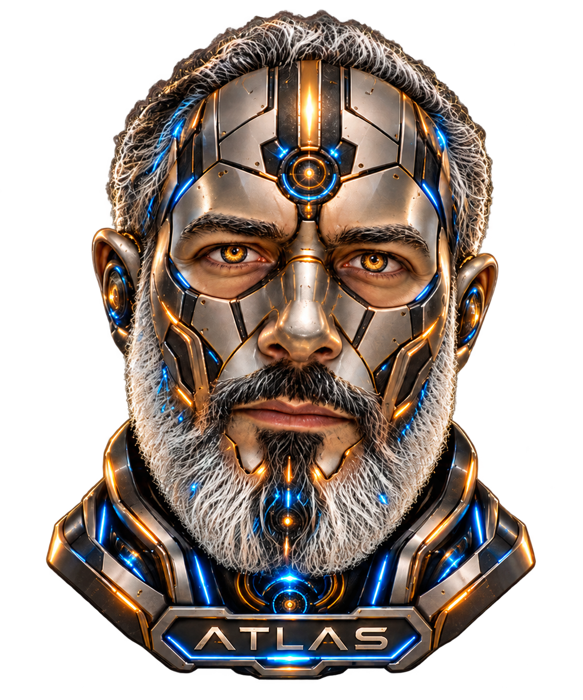

# ATLAS

### Assistant personnel local, vocal et francophone

**Projet en cours de développement pour Windows 11, sur mini-PC GTR7.**

*Portrait de travail validé visuellement par le propriétaire le 12 novembre 2026.*

---

## Présentation

ATLAS est un assistant personnel dont l'objectif est de fonctionner localement, avec reconnaissance de la voix, conversation en français, mémoire, outils et interface de bureau PyQt6.

Le développement est encore en cours. Les composants présents dans le dépôt ne constituent pas une garantie que toutes les fonctionnalités sont déjà opérationnelles ou testées de bout en bout.

## Statut technique

| Élément | Situation actuelle |
| --- | --- |
| Identité visuelle | Portrait de travail approuvé et versionné sur cette branche |
| Affichage | Code PyQt6 existant ; contrôle réel Windows/GTR7 non effectué |
| Animation faciale articulée | Non implémentée dans le rendu de production |
| Tests du portrait | 15 tests réussis sous Linux/Qt hors écran, selon le rapport Codex ; non reproduits sous Windows |
| Moteur Python | Migration des anciens noms internes préparée séparément, non intégrée à cette branche |
| Voix, outils et mémoire | Développement et validations fonctionnelles encore en cours |
| Installateur Windows | Ne pas considérer cette branche comme une version finale prête à déployer |

### Organisation des développements

- **Branche d'intégration autorisée :** `develop-atlas`.
- **Portrait approuvé :** branche `chore/lot5-approved-portrait`.
- **Protection de l'asset :** [PR n°18](https://github.com/Rachid-Coaching-Life/ATLAS/pull/18).
- **Audit de l'animation du robot :** [PR n°17](https://github.com/Rachid-Coaching-Life/ATLAS/pull/17).
- **Migration du moteur Python :** [PR n°12](https://github.com/Rachid-Coaching-Life/ATLAS/pull/12), à réconcilier avec les développements récents avant toute intégration.

### Priorité : animation fidèle du robot

La version approuvée du portrait doit conserver les traits, les cheveux, la barbe, les proportions et l'armure du robot. Les prochaines étapes concernent la déformation du visage, le clignement, la synchronisation de la bouche avec la lecture audio et l'intégration de ces animations dans ATLAS.

Aucun ancien dessin géométrique ou portrait alternatif ne doit remplacer l'identité visuelle approuvée.

## Installation et tests

**Aucun téléchargement public ni installateur définitif n'est annoncé par ce README.** L'installation et le fonctionnement doivent être validés pour Windows 11 et le GTR7 avant publication.

Les tests de l'environnement cloud peuvent vérifier du code et des rendus hors écran, mais ils ne remplacent pas la validation finale de l'interface et du son sur la machine cible.

## Respect des données et du code d'origine

Le logiciel vise un fonctionnement local, avec traitement des données personnelles sur l'ordinateur de l'utilisateur.

Les mentions de licence, droits d'auteur et attributions applicables au code repris sont conservées dans [LICENSE](LICENSE). La migration des noms internes doit préserver la compatibilité des données et configurations existantes.
